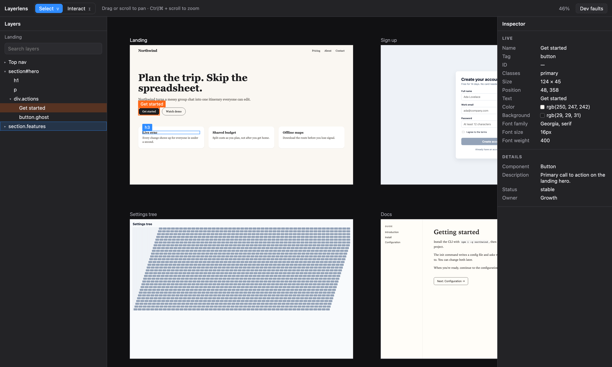
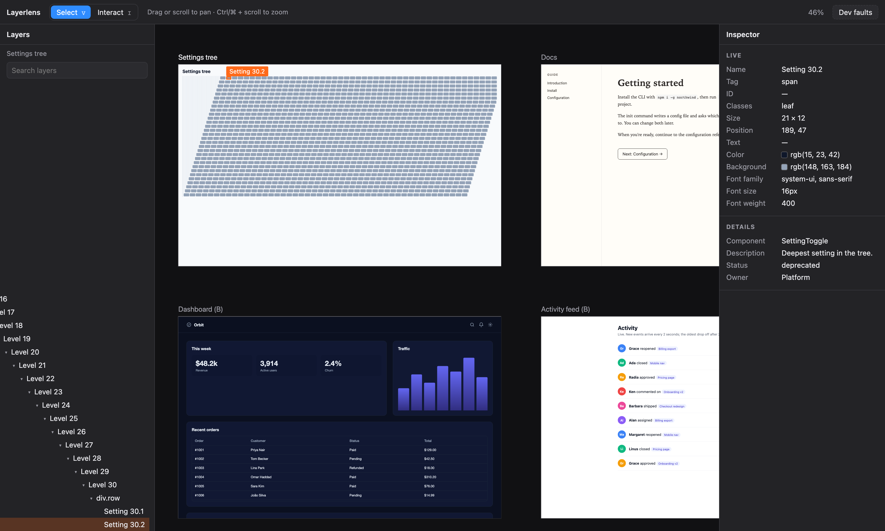
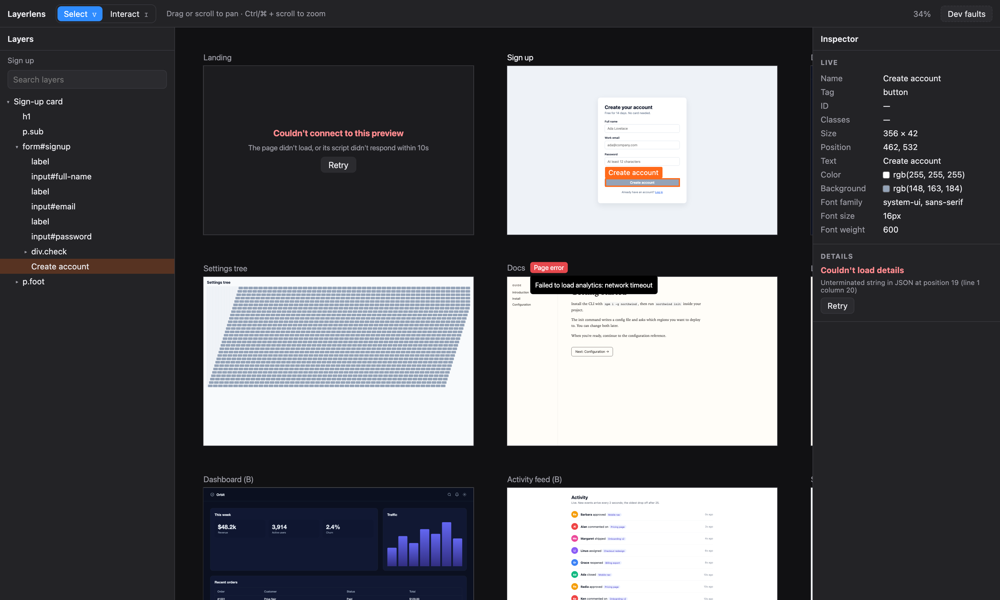

# Layerlens

**Layerlens** is a board of live web-page previews that you can inspect like a design tool. Each preview is an iframe on a different origin, so the app can't touch the page's DOM. Instead, a small script in each page talks to the app over `postMessage`. Hover and select any element and the outlines stay pixel-exact through pan, zoom and scroll. You can browse a lazy-loaded layers tree with search, and inspect live styles plus details from an API. Elements keep their identity when a page re-renders or navigates. Every failure is contained to its own region, with Retry, and reported exactly once.

Built for the Figr frontend engineer assignment. The brief is in [BRIEF.md](BRIEF.md).

## Screenshots

**Select an element.** The 2px outline and label stay glued to it. Its row is revealed in the layers panel, and the inspector shows live values plus details from the API. The hover outline (1px, blue) is on a feature card heading.



**Deep trees load on demand.** Selecting a leaf 30 levels down loads and expands every ancestor, then scrolls the panel to its row.



**Failures stay in their region.** Here one preview's page never answered, a Details request failed, and another page threw its own error (badge, message on hover). Everything else keeps working, and each failure has its own Retry.



To regenerate them: `npm run screenshots`.

## Run

```
npm install
npm run dev
```

Node 18+. This starts the mock backend (API on :4000, pages on :4001) and the app on http://localhost:5173. The **Dev faults** menu in the toolbar (dev builds only) triggers every failure from R6 on demand.

## Tests

```
npx playwright install chromium   # once (or: npm run test:setup)
npm test                          # unit, then end-to-end
npm run test:unit                 # Vitest only (~2s)
npm run test:e2e                  # Playwright only; starts the backend and app itself
npm run test:e2e:ui               # Playwright's UI, to watch each test run
```

- **Unit** ([frontend/test/](frontend/test/), Vitest + jsdom): tree helpers, API validation, the host side of the protocol (handshake, timeouts, cancellation, stale page loads), store actions, failure regions and reporting, the inspector. The page bridge is loaded into a jsdom child frame to test element identity across re-renders, keyboard navigation, search, key forwarding and page errors.
- **End-to-end** ([e2e/](e2e/), Playwright + Chromium, against the real backend): one spec per requirement, `r1-board` to `r6-failures`. They check outline geometry against the element's real box in the page, and read every `report()` call from the console to assert exactly-once reporting. Failures are triggered through the Dev faults menu, as in the video.

## Layout

```
backend/pages/figr-bridge.js   the one <script> added to each page
frontend/src/
  protocol.ts                  host <-> page message shapes
  connection.ts                one Connection per iframe: handshake, requests, timeouts
  state.ts                     the store (useSyncExternalStore, no library)
  actions/                     every state change:
    pages.ts                     connections, page messages, which elements pages watch
    board.ts                     screens, mode, pan and zoom
    selection.ts                 hover, selection, keyboard shortcuts
    layers.ts                    layers tree loading, reveal, panel keys, search
    dev.ts                       Dev faults menu triggers
  tree.ts                      pure layers-tree helpers
  api.ts                       GET /screens, GET /elements/:key, with validation
  components/                  Board, Preview, Overlay, LayersPanel, Inspector, Region, DevMenu, Splitter (resizable panels)
```

## Decisions on ambiguous requirements

- **What counts as an element in the tree.** `<script>`, `<style>`, `<template>` and `<noscript>` are left out: they never render, so they can't be hovered.
- **Page errors are not reported.** `report()` is for failures of this app. An error thrown by the page's own code (page 1's "Watch demo", page 6's rejection) only shows the "Page error" badge.
- **Search vs. expanded state.** While a search is open, selecting something doesn't expand the normal tree, so clearing the search restores exactly the state from before it.
- **Collapsing a row while it loads** cancels the request (the user moved on): no error and no report. Expanding again starts a new request.
- **Keyboard navigation (Enter / Tab) only runs in Select mode.** In Interact mode those keys belong to the page.
- **Enter / Tab drive the selection only when focus is on the board or the layers list.** On a focused toolbar or panel control they keep their usual meaning, so the app stays keyboard-navigable. Clicking a preview or empty board space returns focus to the board.
- **The top level not loading fails the whole layers panel.** There is no row to show "Couldn't load" on: the top level is the panel's own content. Retry reloads the panel.
- **A search the page doesn't answer** shows "Couldn't search" with Retry under the search box, like a row's "Couldn't load". The rest of the panel keeps working. A failed search isn't re-run automatically when the page changes, so a hung page can't produce a report every few seconds.
- **A page that stops answering is that preview's failure.** If a hit test (hover or click) or an Enter / Tab step gets no answer within 1s, the preview shows its error with Retry and it is reported. A newer hover only makes an older answer stale, which is dropped, not a failure.
- **Ctrl/Cmd + wheel zooms over the board**, previews included. Over the side panels it's left to the browser.
- **The connect timeout** also applies after navigation: if the next page doesn't answer within 10s, the preview shows "Couldn't connect".

## State: what lives where, and who changes it

- **One store** ([state.ts](frontend/src/state.ts)) holds everything shared: mode, camera, screens, per-preview connection status and page errors, hover, selection, element boxes (`rects`), live values, and one layers tree per preview.
- **Only [actions/](frontend/src/actions/) writes to the store.** Components read it with `useStore(selector)` and call actions. Each file there owns one concern; page messages are routed in [pages.ts](frontend/src/actions/pages.ts).
- **Component-local state** is limited to things no one else needs: the screens fetch result, the Details fetch state, and the drag-in-progress.
- **The bridge owns element identity.** The host only ever holds opaque ids (`"n42"`). It never decides whether two DOM nodes are the same element.
- **Each layers tree is tied to one page load (`docId`).** A navigation or board reload creates a new tree, which resets expanded rows, scroll position and selection for that preview.

## Host ↔ page protocol

The full message list is in [protocol.ts](frontend/src/protocol.ts).

- **Handshake.** The bridge posts `hello` to its parent. The host replies `init` (also sent on iframe `load`, in case `hello` was missed). The bridge locks onto the host's origin and answers `ready` with a fresh `docId`. After that, both sides check origin and source on every message.
- **Requests** (`hit`, `children`, `nav`, `search`) carry a `reqId` and have a timeout: 1s for hit-testing, 3s for children and search. A late answer is dropped.
- **Pushes.** For the ids the host *watches* (hover plus selection), the page polls their boxes and live values every animation frame and sends only changes. One loop covers page scroll, inner scroll areas, animations, resizes and DOM moves.
- **DOM changes.** A `MutationObserver` batches changes (30ms), then re-binds or drops lost ids (`gone`), resends child lists of parents the host has loaded (`children`), and sends `dirty` so an open search re-runs.
- **Slow page.** A row that doesn't load within 3s shows "Couldn't load" with Retry. A page that doesn't say `ready` within 10s shows "Couldn't connect". A connected page that doesn't answer a hit test or keyboard step within 1s fails its preview.
- **Gone or replaced page.** The bridge sends `bye` on `pagehide`. The host cancels pending requests (cancelled requests are not failures), clears that preview's selection, hover and tree, and waits for the new page's `ready`. Messages carrying an old `docId` are ignored.
- **Select mode.** A transparent layer over each iframe captures the pointer, so the page never sees a click: links don't navigate, buttons don't act, forms don't submit. Hit-testing is done in the page with `elementFromPoint`, which also finds disabled controls, SVG children, and whatever is visible above or below a sticky header. The wheel is forwarded to the page and scrolls the innermost scrollable element under the pointer. The bridge also blurs anything that gains focus.
- **Keys.** If the page has focus, the bridge forwards shortcuts to the host, so V, I, Escape, Enter and Tab work right after clicking inside a preview.

## Element identity across re-renders

- Each id stores a **locator**: the nearest ancestor with `data-key` or `id`, then one step per level down to the element. Each step records tag, class and `data-name`, plus the element's text with digits normalised, so "2s ago" still matches "4s ago".
- When an element is detached, the bridge resolves its locator against the new DOM. **The id is re-bound only if every step matches exactly one node.** If any step is ambiguous or missing, the id is reported `gone`.
- So the selection can disappear, but it never moves to a node that matched only partially.

## Where this breaks

- **Selection can move to a different element in one case.** A page removes an unkeyed element and, in the same render, inserts a *different* element with the same tag, class, name and (digit-normalised) text in the same position under the same anchor. The locator can't tell them apart.
- **An unkeyed element whose text changes in a non-numeric way *and* is re-created in the same render** is treated as gone, even though a person would say it's the same element.
- **Two identical unkeyed siblings** (same tag, class and text) can't survive a re-render. They are dropped, not swapped.
- **Clipping** follows `overflow` on ancestors. It doesn't account for `position: fixed` escaping a clipped ancestor, `clip-path`, or elements covered by others (a row under a sticky table header still shows its outline).
- **Watching costs.** Watched elements are polled every frame. That's cheap for a selection of a few elements, but selecting hundreds would cost real time per frame.
- **Search** returns at most 500 matches.

## How AI was used

I made the design decisions. I used Claude (via Claude Code) for implementation, review and tests.

**What I decided before any code was written:**

- **High-level design.** The app never touches a page's DOM. A small bridge script inside each page does hit-testing, reads boxes and styles, and owns element identity. The app holds only opaque ids and talks to pages over `postMessage`.
- **State model.** One store, written only by actions. Anything tied to one page load is keyed by its `docId`, so a navigation starts that preview fresh.
- **Protocol.** A handshake that locks onto the host's origin, requests with ids and timeouts, and pushes only for the elements being watched.
- **Failure model.** One region per area of the UI. Errors from anywhere reach their region the same way. Each failure is reported exactly once, and cancellations are never failures.
- **Code structure and UI.** The folders, which components exist and what each one owns, the pure tree helpers, and the layout: layers on the left, board in the centre, inspector on the right, dev faults in the toolbar.

**What Claude did, with my review:**

- Wrote most of the implementation from those decisions.
- Audited the build against the brief and proposed fixes and refactors. One example is splitting the actions file into one module per concern. I reviewed each proposal and kept the ones that fit the design.
- Wrote the unit tests (Vitest) and the end-to-end tests (Playwright), captured the screenshots in this README, and drafted [CLAUDE.md](CLAUDE.md).

**Where it got things wrong:**

- **Its first audit against the brief missed a dev-menu bug.** A silenced preview fails and can't be clicked, so it can't become active again, and the menu only offered "un-silence" for the active preview. The bug only surfaced when an end-to-end test tried to un-silence a preview after selecting something else.
- **Several of its first end-to-end tests clicked the wrong element.** Clicking the centre of a table row lands on a `td`, and clicking a list item lands on its child, so the tests selected something other than what they asserted on.
- **Its first way of making a page unresponsive in tests didn't work.** It added a message listener to swallow messages, but the bridge's own listener was registered first and still answered. The fix was to serve the bridge behind a mute switch in that test.
- **A bulk find-and-replace in a refactor changed the board-timer fault.** It turned a guarded timer callback into code that ran immediately. This was caught on review, before running anything.
- **The end-to-end suite silently reused my running dev server.** After a refactor that server was serving stale code, so all 72 tests failed. The suite now starts its own servers on separate ports.

**What I checked myself:**

- Every change had to pass the full test suite, the type checker and the linter before it was committed, and I reviewed the diffs.
- I went through each requirement (R1–R6) by hand in the browser, including every Dev faults trigger.
- I read the screenshots and test assertions against the brief, not just the passing counts.
